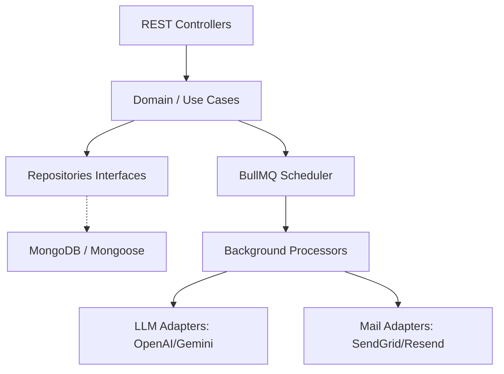

<div align="center">
  

  # 🚀 Injaazh Lead AI
  **The Next-Generation AI Context & Automated Email Campaign Engine**

  <p>
    <a href="https://nestjs.com/"></a>
    <a href="https://www.mongodb.com/"></a>
    <a href="https://bullmq.io/"></a>
    <a href="https://www.typescriptlang.org/"></a>
  </p>

  <p>
    <em>Built with Clean Architecture, highly scalable queues, and decoupled AI adapters.</em>
  </p>
</div>

---

## 🌟 Overview

**Injaazh Lead AI** is a highly scalable, multi-tenant enterprise backend built with **NestJS**. It is designed to automate the entire lifecycle of lead engagement—from scraping and intelligence gathering to AI-driven context generation, and smart sequence-based email campaigns.

Our philosophy is strictly **Clean Architecture**. The core business logic is completely isolated from the infrastructure, ensuring that Third-Party dependencies (like OpenAI, Claude, SendGrid, Resend) are seamlessly plugged in via the Adapter Pattern.

## ✨ Key Features

- 🧠 **AI Context Engine**: Generates rich prospect intelligence (pain points, buying signals, tech stack) via dynamic pipelines *without* tightly coupling to a specific LLM provider.
- ✉️ **Email & Campaign Engine**: Smart follow-up sequences (Email -> Wait -> Email -> Stop if Replied).
- 🔄 **Scheduler Engine**: Built on top of robust Redis-backed **BullMQ** for reliable job processing, retries, rate limiting, and delayed background execution.
- 📬 **Mail Provider Agnostic**: Seamlessly swap between Gmail, SendGrid, Amazon SES, and Resend using simple Factory Adapters.
- 🎯 **Advanced Tracking**: Real-time Pixel and Link wrapping for instantaneous Open, Click, Reply, Bounce, and Unsubscribe tracking.
- 📊 **Analytics Engine**: Pre-built aggregations for Open Rates, Reply Rates, Conversion Rates, and individual Campaign performance metrics.

---

## 🏗️ Architecture



### Module Breakdown

| Module | Responsibility |
|--------|----------------|
| `AI / LLM` | Adapter layer for Gemini/OpenAI and Prompt Template Management. |
| `Campaigns` | Manages active campaigns, lead enrollment, and halting conditions. |
| `Sequences` | Defines smart follow-up trees (e.g. Day 1 Email, Wait 3 Days). |
| `Tracking` | Processes webhooks and transparent 1x1 pixel tracking. |
| `Analytics` | Aggregates MongoDB queries for Dashboard charts and metrics. |
| `Scraper` | Fire-and-forget background jobs for parsing raw HTML into company profiles. |

---

## 🚀 Getting Started

### Prerequisites

- **Node.js** (v20+ recommended)
- **MongoDB** (Local or Atlas)
- **Redis** (Required for BullMQ scheduling)

### 1. Installation

Clone the repository and install the dependencies for the Monorepo:

```bash
git clone https://github.com/your-username/injaazh-lead-ai.git
cd injaazh-lead-ai
pnpm install
```

### 2. Environment Variables

Create a `.env` file in `apps/api/.env` and configure your local settings:

```env
PORT=3001
API_BASE_URL=http://localhost:3001

# Database & Queue
MONGODB_URI=mongodb://localhost:27017/injaazh
REDIS_HOST=127.0.0.1
REDIS_PORT=6379

# JWT
JWT_SECRET=your_super_secret_key
JWT_EXPIRES_IN=1d

# Providers (Optional for local testing)
OPENAI_API_KEY=sk-...
SENDGRID_API_KEY=SG....
```

### 3. Running the Server

Start the API in development mode with Hot Reload:

```bash
cd apps/api
pnpm run start:dev
```

The API will be available at `http://localhost:3001`.

---

## 📚 API Documentation (Swagger)

We use Swagger for interactive API exploration. Once the server is running, navigate to:

👉 **[http://localhost:3001/api/docs](http://localhost:3001/api/docs)**

From there, you can view the request/response DTOs, authenticate via Bearer token, and dispatch requests directly from the UI.

---

## 🧪 Testing

The repository includes several custom CLI scratch scripts to verify the core engines (Scraping, AI Context, Mail Dispatch, Analytics). 

To run the complete test suite:

```bash
pnpm run test
pnpm run test:e2e
```

---

<div align="center">
  <p>Built with ❤️ by the Injaazh Team</p>
</div>
